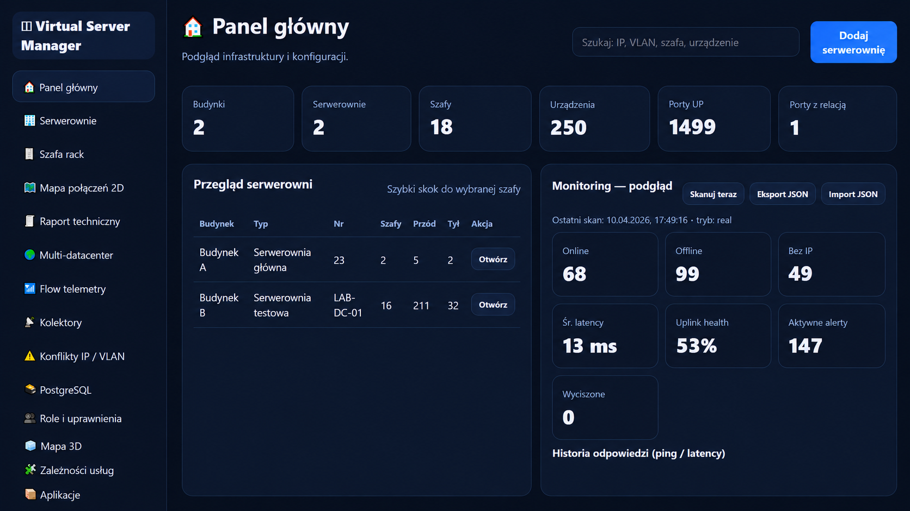
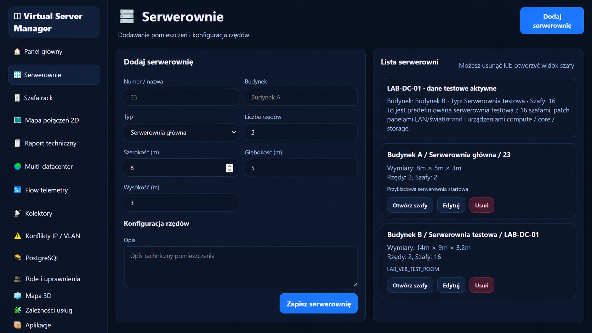
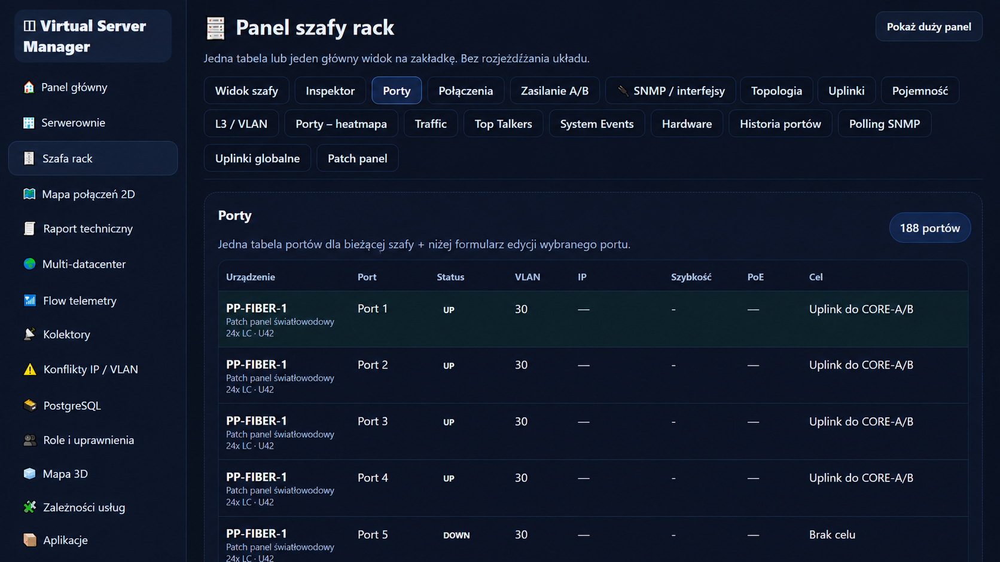
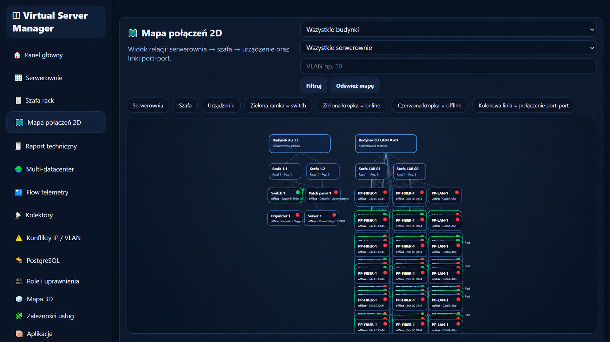

# Virtual Server Manager

**Virtual Server Manager** to panel do ogarniania serwerów, sieci i usług z jednego miejsca. Powstał z myślą o własnym homelabie, VPS-ach i większych środowiskach, gdzie po pewnym czasie zaczyna brakować jednego sensownego widoku na całość.

Nie trzeba skakać między kilkoma panelami. W jednym miejscu masz serwerownie, szafy rack, urządzenia, porty, monitoring, mapę połączeń, terminal SSH i narzędzia administracyjne.

[**⬇️ Pobierz program**](http://testpro.com.pl/wp-content/uploads/2026/04/virtual-server-manager-windows.zip) · [**Zobacz funkcje**](https://testpro.com.pl/virtual-serwer-menager/#funkcje)

## Panel główny

Na starcie dostajesz szybki podgląd infrastruktury: liczbę serwerowni, szaf, urządzeń, aktywnych portów i najważniejsze informacje z monitoringu.



## Co potrafi

### Serwerownie i szafy rack

Możesz tworzyć serwerownie, opisywać ich układ, dodawać szafy i porządkować sprzęt tak, żeby później dało się to normalnie odnaleźć.



### Porty, VLAN-y i połączenia

Widok szafy pokazuje urządzenia, porty, statusy, VLAN-y, adresy IP, uplinki i inne informacje przydatne przy codziennej pracy z infrastrukturą.



### Mapa połączeń 2D

Mapa pozwala zobaczyć zależności pomiędzy serwerownią, szafą, urządzeniami i portami. Przy większej liczbie urządzeń daje znacznie lepszy obraz niż zwykła lista.



### Monitoring

W projekcie znajdują się m.in.:

- podgląd stanu urządzeń,
- CPU, RAM, dysk i uptime hostów,
- monitoring interfejsów,
- SNMP,
- historia odpowiedzi i opóźnień,
- telemetria,
- alerty i zdarzenia.

### Administracja

Virtual Server Manager rozwija się również w kierunku codziennych operacji administracyjnych:

- terminal SSH w przeglądarce,
- profile połączeń,
- zarządzanie usługami i procesami,
- podstawowe operacje Docker,
- backup i restore,
- harmonogram zadań,
- role i uprawnienia,
- log operacji,
- 2FA TOTP,
- integracje LDAP oraz PostgreSQL.

## Wymagania

Do uruchomienia potrzebny jest:

**Node.js 18 lub nowszy**

Na Windows najprościej uruchomić:

```text
start_windows.bat
```

Skrypt sprawdzi zależności i w razie potrzeby uruchomi `npm install`.

Panel działa domyślnie pod adresem:

```text
http://127.0.0.1:3080
```

Do diagnostyki można użyć:

```text
start_windows_debug.bat
```

## Linux

```bash
chmod +x start_linux.sh stop_linux.sh
./start_linux.sh
```

## macOS

```bash
chmod +x start_macos.command stop_macos.command
./start_macos.command
```

## Pierwsze uruchomienie

W lokalnej wersji startowej domyślne konto to:

```text
login: admin
hasło: admin123
```

Przy normalnym wdrożeniu zmień hasło przed wystawieniem panelu do sieci. Możesz ustawić własne wartości przez zmienne środowiskowe:

```text
VSM_ADMIN_PASSWORD=twoje_mocne_haslo
VSM_SESSION_SECRET=dlugi_losowy_sekret
VSM_AGENT_SHARED_TOKEN=losowy_token_agentow
```

Nie wystawiaj panelu bezpośrednio do Internetu bez HTTPS, reverse proxy i kontroli dostępu. Program ma funkcje administracyjne, więc warto traktować go jak normalny panel zarządzający infrastrukturą.

## Dane lokalne

Publiczne repo nie zawiera lokalnego `data/storage.json`, backupów, transcriptów terminala ani logów runtime. Takie pliki mogą zawierać dane dostępowe albo informacje o Twojej infrastrukturze i powinny zostać lokalnie.

`data/storage.json` tworzy się automatycznie przy pierwszym uruchomieniu.

## Technologie

Projekt korzysta m.in. z:

- Node.js,
- Express,
- Socket.IO,
- node-pty,
- net-snmp,
- PostgreSQL,
- xterm,
- bcryptjs.

## Roadmap

Dalszy plan rozwoju znajduje się w pliku [`ROADMAP.md`](ROADMAP.md).

## Autor

**Heterodyna Team Software**  
https://heterodynateamsoftware.pl

---

## English

**Virtual Server Manager** is a server and infrastructure management panel for homelabs, VPS environments and larger setups.

It brings server rooms, racks, devices, ports, monitoring, network maps, SSH access and administrative tools into one place.

### Requirements

**Node.js 18 or newer**

### Main features

- server room and rack management,
- devices, ports and VLANs,
- 2D network map,
- host and SNMP monitoring,
- browser-based SSH terminal,
- services and process management,
- basic Docker operations,
- backups and scheduled tasks,
- users, roles, audit log and TOTP 2FA,
- PostgreSQL and LDAP integrations.

## License

MIT
